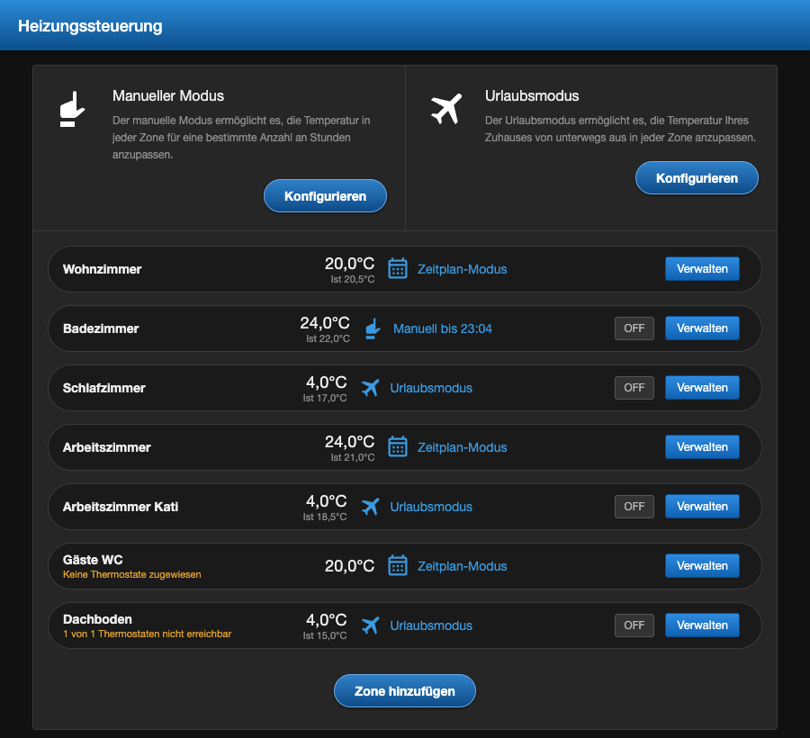
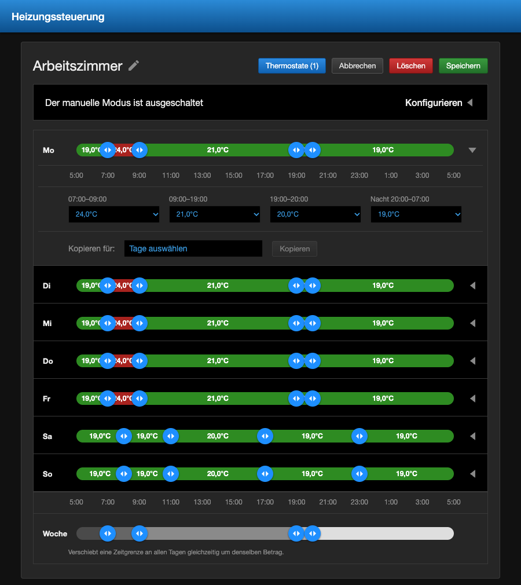
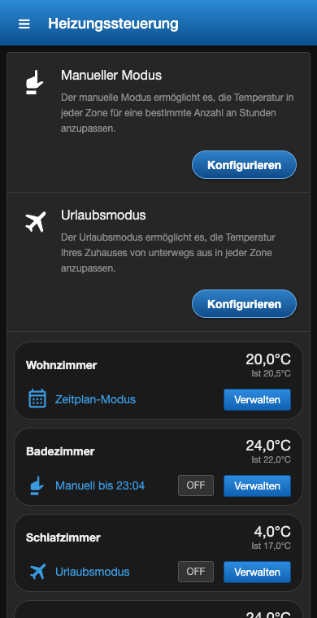

# Heating Panel für Home Assistant

[](https://hacs.xyz/)
[](https://github.com/Media-and-IT/ha_heatingpanel/actions/workflows/validate.yml)
[](LICENSE)

**English:** [README.md](README.md)

Eine eigene Seite in der Seitenleiste, über die du deine Heizkörperthermostate komplett per Oberfläche steuerst.
Thermostate zu Zonen zusammenfassen, Wochenzeitplan per Schieberegler einstellen, kurz hochheizen, wenn jemand
friert, und das ganze Haus in den Urlaubsmodus schicken. Kein YAML, keine Automationen, keine Helfer.



## Funktionen

- **Zonen**: je Raum oder je Heizkörper eine Zone mit einem oder mehreren `climate`-Thermostaten.
- **Zeitplan**: pro Wochentag fünf aneinandergrenzende Zeitfenster. Grenzen im 15-Minuten-Raster ziehen,
  je Zeitfenster eine Temperatur wählen. Das erste und das letzte Fenster bilden die Nacht und teilen sich eine Temperatur.
- **Tage kopieren**: Montag einstellen und auf die ganze Woche, alle Arbeitstage oder einzelne Tage übertragen.
- **Wochenregler**: verschiebt eine Grenze an allen Tagen um denselben Betrag. Unterschiedliche Zeiten (z. B. Wochenende) bleiben erhalten.
- **Manueller Modus**: eine feste Temperatur für 1 bis 24 Stunden, danach gilt wieder der Zeitplan.
- **Urlaubsmodus**: eine feste Temperatur, bis du ihn ausschaltest.
- **Aktionen** für Automationen, z. B. Urlaubsmodus, wenn alle das Haus verlassen haben.
- Läuft auf dem Handy, folgt deiner Sprache (Deutsch und Englisch) und deinem Einheitensystem (°C oder °F).

## Installation

### HACS

[](https://my.home-assistant.io/redirect/hacs_repository/?owner=Media-and-IT&repository=ha_heatingpanel&category=integration)

1. HACS öffnen, oben rechts das Menü öffnen und **Benutzerdefinierte Repositories** wählen.
2. `https://github.com/Media-and-IT/ha_heatingpanel` mit dem Typ **Integration** hinzufügen.
3. In HACS nach **Heating Panel** suchen und herunterladen.
4. Home Assistant neu starten.

### Manuell

Den Ordner `custom_components/heatingpanel` aus dem [neuesten Release](https://github.com/Media-and-IT/ha_heatingpanel/releases)
in den Ordner `custom_components` deiner Home-Assistant-Konfiguration kopieren und Home Assistant neu starten.

## Einrichtung

[](https://my.home-assistant.io/redirect/config_flow_start/?domain=heatingpanel)

Unter **Einstellungen, Geräte & Dienste, Integration hinzufügen** die Integration **Heating Panel** wählen.
In der Seitenleiste erscheint der Eintrag **Heizung**. Titel und Symbol lassen sich in den Optionen der Integration ändern.

## Bedienung



1. **Zone hinzufügen** wählen, einen Namen vergeben und unter **Thermostate** die Thermostate der Zone anhaken.
2. Montag aufklappen, die Grenzen ziehen und je Zeitfenster eine Temperatur wählen.
3. Unter **Kopieren für** z. B. **Arbeitstage** wählen, **Kopieren** und dann **Speichern**.

Am Rechner lassen sich die Griffe auch mit den Pfeiltasten bewegen, mit gedrückter Umschalttaste in Stundenschritten.



## Wie geregelt wird

- Ein Tag im Zeitplan läuft von **05:00 bis 05:00** am Folgetag. Die Nacht gehört also zum Vorabend.
- **Manuell** hat Vorrang vor **Urlaub**, Urlaub vor dem **Zeitplan**. Ein manueller Boost im Urlaubsmodus
  fällt nach Ablauf wieder auf die Urlaubstemperatur zurück.
- Die Integration berechnet jede Minute das Ziel jeder Zone und sendet es **nur, wenn es sich ändert**
  (und nach einem Neustart). Wer am Thermostat selbst dreht, behält seinen Wert bis zum nächsten Wechsel.
- Thermostate im Modus **Aus** werden nicht angefasst, z. B. im Sommer. Sobald sie wieder an sind, bekommen sie das aktuelle Ziel.
- Nicht erreichbare Thermostate werden jede Minute erneut versucht.
- Das Ziel wird auf `min_temp` und `max_temp` des jeweiligen Thermostats begrenzt.
- Temperaturen werden in der Einheit deiner Home-Assistant-Instanz gespeichert. Wechselst du später zwischen °C und °F, prüfe deine Zeitpläne.

## Aktionen

Zonen werden per Name angegeben. Bleibt `zones` leer, gilt die Aktion für alle Zonen.

| Aktion | Felder |
| --- | --- |
| `heatingpanel.set_vacation` | `zones`, `temperature` |
| `heatingpanel.clear_vacation` | `zones` |
| `heatingpanel.set_manual` | `zones`, `temperature`, `hours` |
| `heatingpanel.clear_manual` | `zones` |

Beispiel: Urlaubsmodus, wenn seit zwei Stunden niemand zu Hause ist.

```yaml
automation:
  - alias: Heizung in den Urlaubsmodus, wenn alle weg sind
    triggers:
      - trigger: state
        entity_id: zone.home
        to: "0"
        for: "02:00:00"
    actions:
      - action: heatingpanel.set_vacation
        data:
          temperature: 15
```

## Fehlersuche

- **Das Panel sieht nach einem Update veraltet aus**: Seite im Browser neu laden, in der App den Frontend-Cache leeren.
- **Ein Thermostat folgt dem Zeitplan nicht**: prüfen, ob es eingeschaltet und der Zone zugewiesen ist.
  Dann auf der Seite der Integration das Debug-Logging aktivieren und nach Zeilen von `custom_components.heatingpanel` suchen.

## Entwicklung

- `custom_components/heatingpanel/` ist die Integration: Speicherung in `.storage/heatingpanel`, Minutentakt,
  die Websocket-API für das Panel und die Aktionen.
- `custom_components/heatingpanel/frontend/heatingpanel-panel.js` ist das Panel, ein Web Component ohne Build-Schritt.

Tests mit Python 3.13:

```bash
pip install -r requirements_test.txt
# das Frontend-Paket muss zur installierten Home-Assistant-Version passen
pip install "$(python -c "import json, homeassistant.components.frontend as f, pathlib; print(json.loads((pathlib.Path(f.__file__).parent / 'manifest.json').read_text())['requirements'][0])")"
python -m pytest -q
```

## Lizenz

[MIT](LICENSE)
