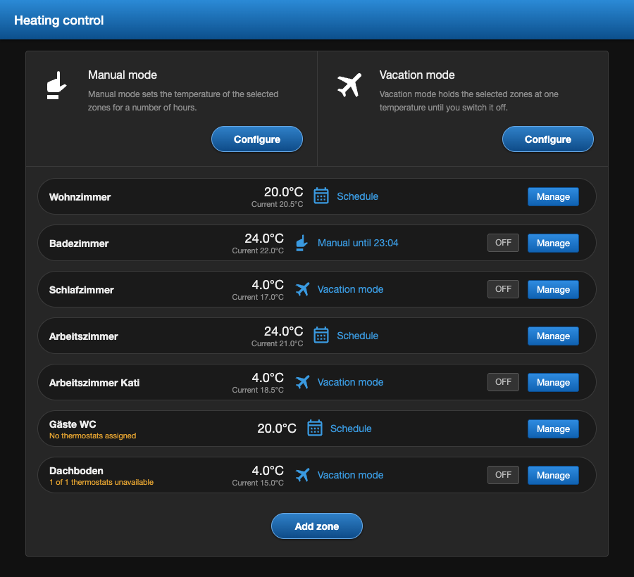
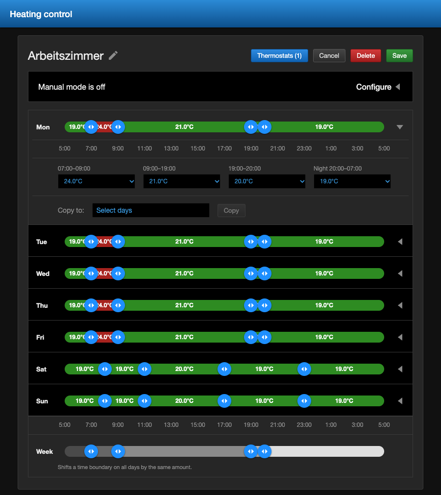
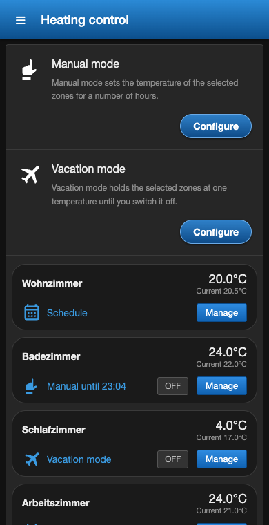

# Heating Panel for Home Assistant

[](https://hacs.xyz/)
[](https://github.com/Media-and-IT/ha_heatingpanel/actions/workflows/validate.yml)
[](LICENSE)

**Deutsch:** [README.de.md](README.de.md)

A sidebar panel to control your radiator thermostats entirely from the UI. Group thermostats into zones,
draw a weekly schedule with sliders, give someone who feels cold a quick boost, and switch the whole house
to vacation mode. No YAML, no automations, no helpers.



## Features

- **Zones**: one zone per room or per radiator, each with one or more `climate` entities.
- **Schedule**: five adjoining periods per weekday. Drag the boundaries in 15 minute steps and pick a
  temperature per period. The first and last period form the night and share one temperature.
- **Copy days**: set up Monday and copy it to the whole week, to all workdays or to single days.
- **Week slider**: shifts one boundary on every day by the same amount. Days with different times keep their differences.
- **Manual mode**: a fixed temperature for 1 to 24 hours, afterwards the schedule applies again.
- **Vacation mode**: a fixed temperature until you switch it off.
- **Actions** for automations, for example vacation mode when everybody has left.
- Works on phones, follows your language (English and German) and your unit system (°C or °F).

## Installation

### HACS

[](https://my.home-assistant.io/redirect/hacs_repository/?owner=Media-and-IT&repository=ha_heatingpanel&category=integration)

1. Open HACS, select the menu in the top right corner and choose **Custom repositories**.
2. Add `https://github.com/Media-and-IT/ha_heatingpanel` with the type **Integration**.
3. Search for **Heating Panel** in HACS and download it.
4. Restart Home Assistant.

### Manual

Copy the folder `custom_components/heatingpanel` of the [latest release](https://github.com/Media-and-IT/ha_heatingpanel/releases)
into the `custom_components` folder of your Home Assistant configuration and restart Home Assistant.

## Setup

[](https://my.home-assistant.io/redirect/config_flow_start/?domain=heatingpanel)

Go to **Settings, Devices & services, Add integration** and choose **Heating Panel**. A new entry
**Heating** appears in the sidebar. Its title and icon can be changed in the options of the integration.

## Usage



1. Select **Add zone**, enter a name and tick the thermostats of the zone under **Thermostats**.
2. Expand Monday, drag the boundaries and choose a temperature for each period.
3. Under **Copy to** choose for example **Workdays**, select **Copy** and then **Save**.

On a computer the slider handles can also be moved with the arrow keys, hold Shift for steps of one hour.



## How it works

- A schedule day runs from **05:00 to 05:00** the next day, so a night belongs to the evening before.
- **Manual** wins over **vacation**, vacation wins over the **schedule**. A boost during vacation mode
  returns to the vacation temperature when it ends.
- Every minute the integration works out the target of each zone and sends it **only when it changes**
  (and after a restart). If someone turns a thermostat by hand, that value stays until the next change.
- Thermostats switched **off** are left alone, for example in summer. Once they are on again they get the current target.
- Thermostats that are unavailable are retried every minute.
- Targets are limited to the `min_temp` and `max_temp` reported by each thermostat.
- Temperatures are stored in the unit of your Home Assistant instance. If you switch between °C and °F later, check your schedules.

## Actions

Zones are given by name. Leave `zones` empty to address all zones.

| Action | Fields |
| --- | --- |
| `heatingpanel.set_vacation` | `zones`, `temperature` |
| `heatingpanel.clear_vacation` | `zones` |
| `heatingpanel.set_manual` | `zones`, `temperature`, `hours` |
| `heatingpanel.clear_manual` | `zones` |

Example: vacation mode when nobody has been home for two hours.

```yaml
automation:
  - alias: Heating to vacation mode when everybody is away
    triggers:
      - trigger: state
        entity_id: zone.home
        to: "0"
        for: "02:00:00"
    actions:
      - action: heatingpanel.set_vacation
        data:
          temperature: 15
```

## Troubleshooting

- **The panel looks outdated after an update**: reload the page in the browser, in the app clear the frontend cache.
- **A thermostat does not follow the schedule**: check that it is not switched off and that it is assigned to the zone.
  Then enable debug logging on the integration page and look for lines from `custom_components.heatingpanel`.

## Development

- `custom_components/heatingpanel/` is the integration: storage in `.storage/heatingpanel`, the minute
  tick, the websocket API used by the panel and the actions.
- `custom_components/heatingpanel/frontend/heatingpanel-panel.js` is the panel, a web component without build step.

Run the tests with Python 3.13:

```bash
pip install -r requirements_test.txt
# the frontend package has to match the installed Home Assistant version
pip install "$(python -c "import json, homeassistant.components.frontend as f, pathlib; print(json.loads((pathlib.Path(f.__file__).parent / 'manifest.json').read_text())['requirements'][0])")"
python -m pytest -q
```

## License

[MIT](LICENSE)
